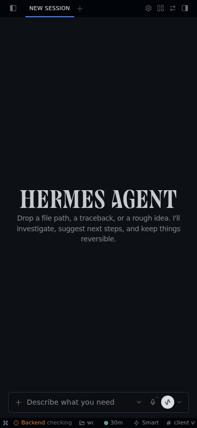
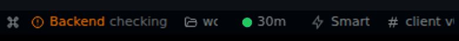
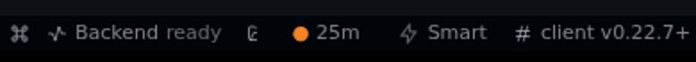
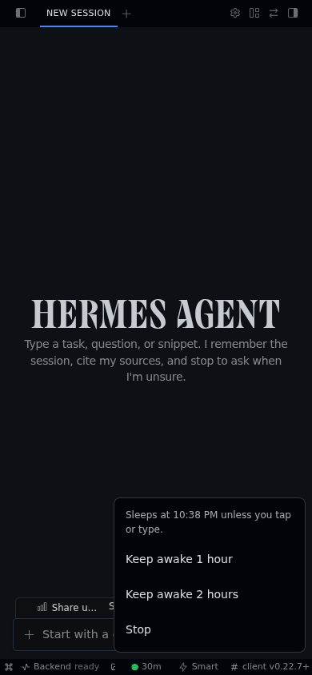
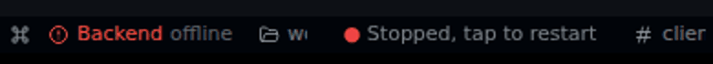
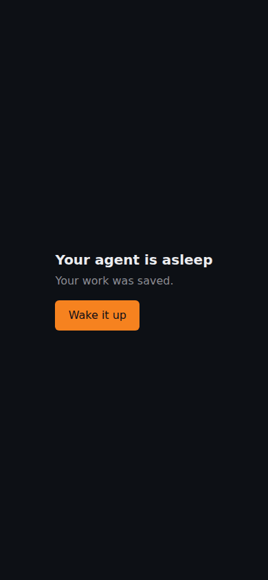
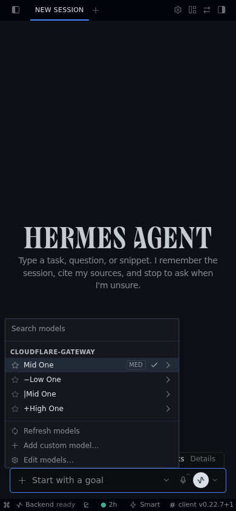

# Using your agent

Your agent is Hermes, an AI assistant that runs on its own private computer in the cloud. That computer sleeps when you're not using it and wakes when you come back. Your chats and files are saved when it sleeps.

## Logging in

1. Go to the address you were given.
2. Cloudflare asks who you are. Enter the email you were invited with and follow the steps.
3. You'll see "Starting your agent". This takes about a minute the first time, and it can take a little longer after a long sleep.

Hermes then opens, ready to use.

## The status chip

The chip is the small dot and time in the bar along the bottom of the screen.

| The dot | What it means |
|---|---|
| Green | You're using it, or you've asked it to stay awake |
| Orange | You haven't tapped or typed for 5 minutes, or a stop is less than 10 minutes away |
| Red | It's stopped |

The time is how long until it next goes to sleep: `30m` is 30 minutes, `2h` is 2 hours.

Tapping or typing in Hermes starts the 30 minutes again. So does your agent working on something, as long as this page stays open. Leaving the page open with nothing happening doesn't. **If you close the page while your agent works, it stops about 30 minutes later, unless you use Keep awake.**

## Keep awake

Tap the chip, then choose **Keep awake 1 hour** or **Keep awake 2 hours**.

The dot stays green and the time counts down from there. The menu tells you when it will stop.

- It runs for that long whether or not you touch anything. At the end, your work is saved and it stops.
- Tapping again starts a new 1 or 2 hours from now. The times don't add up, so 2 hours is the most you can have.
- The dot turns orange 10 minutes before the end. If you need longer, tap Keep awake again.

## Stop

Tap the chip, then **Stop**. Your work is saved first, and then it stops. There's no need to do this: it goes to sleep by itself. Stop is for when you're finished and don't want it running any longer.

## Restarting after a stop

The dot turns red and the chip says **Stopped, tap to restart**. Tap it. The page reloads and your agent starts again, with your chats and files where you left them.

If you open the page and see "Your agent is asleep", tap **Wake it up**.

## If a stopped tab looks wrong

A tab left open for hours can sometimes show a "Let's get you setup with Hermes Agent" box, or "Starting Hermes…" that never finishes. Nothing is lost. **Reload the page.**

Just after a restart, you may see "Setup is taking longer than usual". Give it a minute: it clears by itself, and you don't need to choose anything.

## If it says "At capacity"

Only so many agents can be awake at once, and that many already are. Your work is safe. Try again in a little while.

## Picking a model

Tap the small arrow in the box where you type. You'll see a list of models. Tap one to use it.

The names in this picture are examples, and it shows older marks. The mark at the start of a name shows what the model costs:

| Mark | Cost |
|---|---|
| `..$` | Low |
| `.$$` | Medium |
| `$$$` | High |
| `*$$$` | Far above the rest |

No mark means it hasn't been scored. These are guides only: you can use any model on your list.
